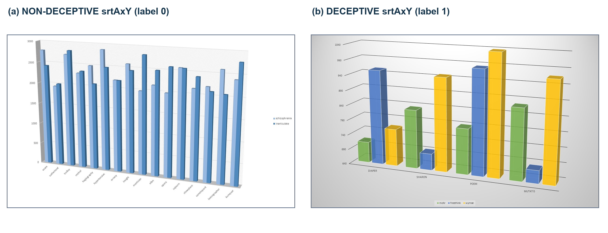
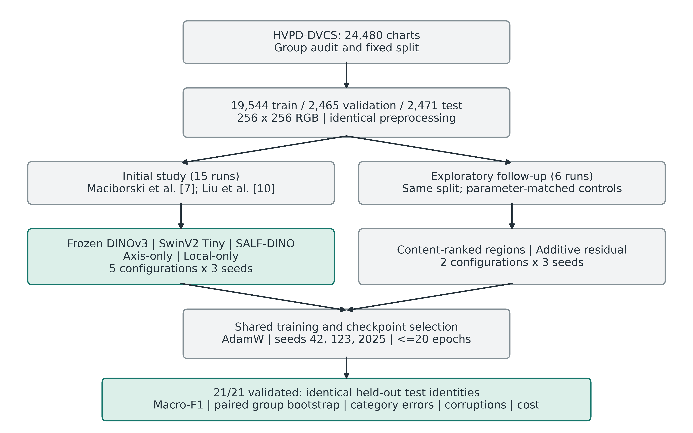
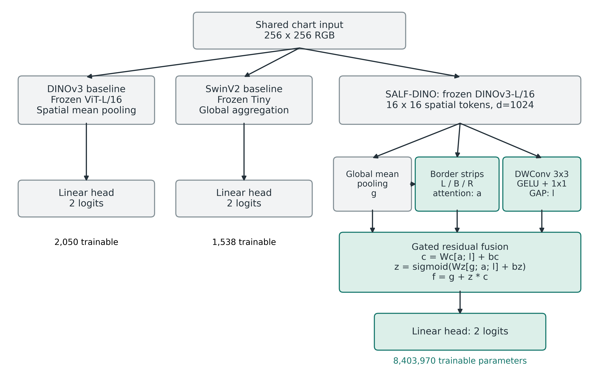
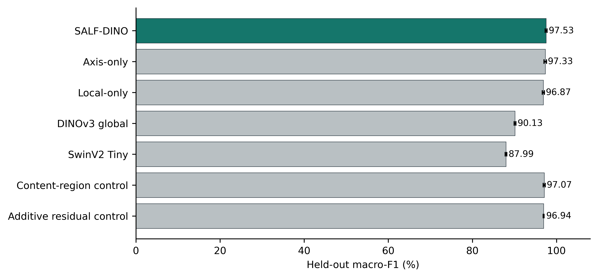
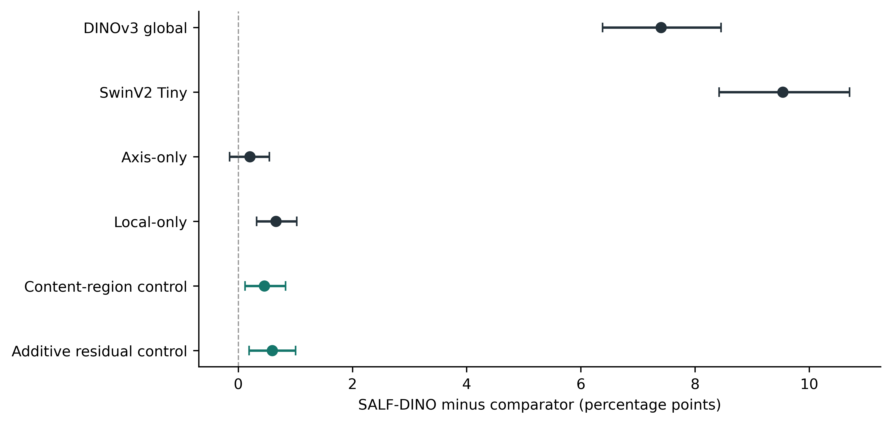
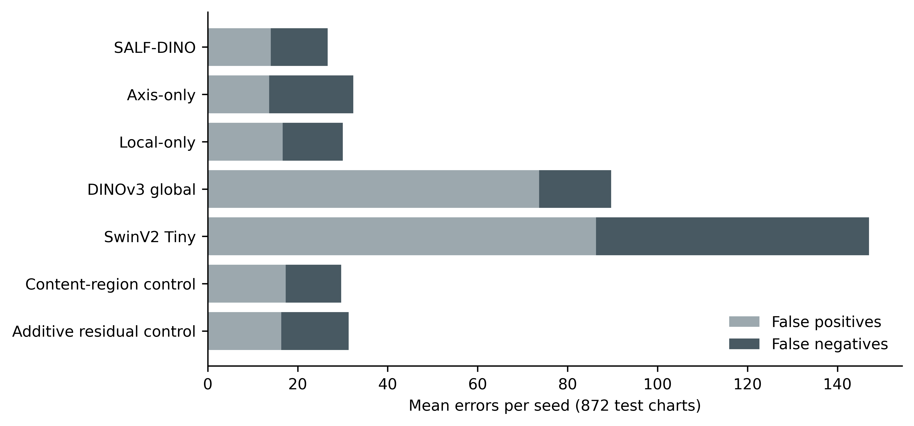
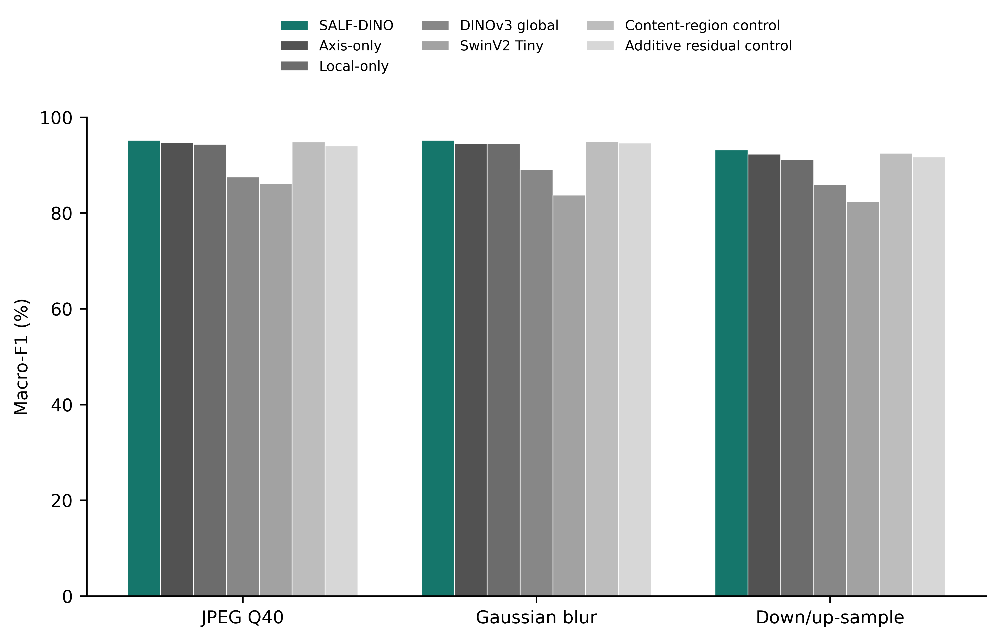

# Axis-Aware Local–Global Feature Fusion for Robust Deceptive Chart Detection

**Proposed method: SALF-DINO | Target journal: IEEE Access | Final experimental evidence release: 26 November 2026**

**Authors:** Yuhefizar; Juanda Hakim Lubis; Mazlina Abdul Majid; Agus Perdana Windarto; Ronal Watrianthos.

All **21/21 model–seed runs** are validated: seven configurations, each with seeds 42, 123 and 2025. This release supersedes the original 15-run and interim 20-run evidence snapshots. The manuscript is being revised to these final results; this README is the evidence-aligned reference for that revision, not a claim that a final paper has already been published.

## Abstract and scientific positioning

SALF-DINO integrates a frozen DINOv3-L/16 global descriptor, attention over predefined chart-border strips, local depthwise patch refinement and multiplicative gated residual fusion. On the audited synthetic HVPD-DVCS split, it achieves 97.53 ± 0.21% held-out macro-F1, compared with 90.13 ± 0.20% for frozen DINOv3 global pooling and 87.99 ± 0.19% for SwinV2 Tiny. Capacity-preserving follow-up comparisons support the fixed border prior relative to content-ranked regional aggregation (+0.46 percentage points, 95% paired group-bootstrap interval +0.12 to +0.83) and multiplicative gating relative to the tested learned additive residual alternative (+0.59 points, interval +0.19 to +1.00). The difference over axis-only remains unresolved (+0.20 points, interval crossing zero). The study reports category errors, corruption performance and computational trade-offs. These are benchmark-specific results, not proof of real-world generalization or superiority to fully fine-tuned published systems.

## Research questions and main contributions

RQ1 (C1) asks whether axis-aware local–global fusion improves overall classification and reduces truncated-Y-axis errors relative to frozen-backbone baselines under a shared group-disjoint protocol. RQ2 (C2) examines the contributions of border aggregation, local refinement and multiplicative fusion through pathway ablations, equal-capacity controls and paired group-bootstrap uncertainty. RQ3 (C3) investigates absolute and relative performance under controlled image degradation and associated parameter and throughput trade-offs.

- **C1 — Axis-aware structural feature fusion:** a task-specific chart-border spatial prior integrated with local and global frozen DINOv3 features, without axis-coordinate annotation (binary supervision is still required).
- **C2 — Capacity-controlled component validation:** three-seed pathway ablations and two equally parameterized controls, with paired held-out-group inference. The controls were designed after the initial results, and reuse the test benchmark; they are exploratory follow-up evidence.
- **C3 — Robustness and computational trade-offs:** matched JPEG, blur and resolution degradation plus parameter counts and recorded throughput.

The novelty is the chart-specific structural integration and its controlled evidence, not attention, convolution or residual fusion individually.

## Table I — Related-work positioning

**Table I. Comparison of representative methods for deceptive chart detection.** Citation numbering follows the current IEEE(5) draft; final numbering must be checked against the revised manuscript.

| Study | Primary objective | Technical approach | Direct relevance and distinction |
|---|---|---|---|
| Lo and Qu [3] | Detect misleading charts | Prompt-based multimodal LLM analysis | Reasoning-focused detection; different evaluation protocol |
| Das and Mueller [4] | Detect, explain, and repair charts | Interactive multimodal LLM dashboard | Interpretability and remediation |
| Song et al. [9] | Detect edited chart images | Watermarking and intent inference | Image tampering differs from deceptive original chart encoding |
| Chen et al. [6] | Deconstruct chart layouts | SVG semantic and spatial extraction | Shows the value of axes and layout representation |
| Zhou et al. [5] | Recover chart knowledge | Object detection, OCR, knowledge graphs | Structural inspiration rather than a binary HVPD classifier |
| Liu et al. [10] | General visual representation | Swin Transformer V2 | Independent architectural comparator |
| Xu et al. [11]; Shi et al. [12] | Fine-grained visual classification | Multi-granularity selection and local refinement | Establish prior art for local–global feature modeling |
| Maciborski et al. [7] | Deceptive chart classification | DINOv3-L/16 using HVPD | Primary predecessor; documented axis-category and robustness weaknesses |
| Tonglet et al. [13] | Misleading-chart benchmark | Misviz real and synthetic chart collections | External evaluation opportunity; not tested here |
| **This study (SALF-DINO)** | Deceptive chart classification | DINOv3, axis-region attention, local refinement, gated fusion | Tests task-specific structural fusion on matched HVPD data |

**Important comparison boundary:** Maciborski et al. [7] reported **98.09% macro-F1** under a **fully fine-tuned** DINOv3 setup. Our **90.13%** frozen DINOv3 global-average baseline is separately trained on our audited split. These numbers cannot be treated as results of a like-for-like cross-paper comparison.

## Table II — Dataset and source images

The **Harmful Visual Plots Dataset (HVPD)** includes the Deceptive Visualization Classification Subset (DVCS), used for the paper's binary deceptive-chart task. The published DVCS class/category breakdown is:

**Table II. Published composition of HVPD-DVCS.**

| Category | Deceptive | Non-deceptive | Total |
|---|---:|---:|---:|
| Truncated Y axis (`srtAxY`) | 4,200 | 4,200 | 8,400 |
| Two Y axes (`twoYaxes`) | 2,046 | 512 | 2,558 |
| 3D pie charts (`3dpie`) | 1,016 | 3,072 | 4,088 |
| Colors and missing scales (`colNoScl`) | 2,560 | 0 | 2,560 |
| Trend hiding through stacking (`trdStck`) | 2,228 | 4,646 | 6,874 |
| **Total** | **12,050** | **12,430** | **24,480** |

The audit used 24,480 valid synthetic DVCS charts and excluded 187 auxiliary web examples. Published category totals and the exact experimental split serve different purposes; the latter is documented in [`data/split_manifest.csv`](data/split_manifest.csv). Because `colNoScl` contains only deceptive ground truth, per-category evaluation reports deception recall/error counts rather than binary-class macro-F1.

**Supplementary Figure S1. Genuine HVPD-DVCS training examples:** (a) non-deceptive and (b) deceptive truncated-Y-axis charts. Both source-image labels and SHA-256 hashes were checked against the audited manifest; **neither is a model prediction**.

Source provenance: [`data/representative_samples_manifest.csv`](data/representative_samples_manifest.csv). A wider nine-panel category overview is available separately at [`figures/Fig_HVPD_DVCS_Representative_Train_Samples.png`](figures/Fig_HVPD_DVCS_Representative_Train_Samples.png), without substituting it for the paper's Figure S1.

## Methods — Figures 1–2 and Table III

### Figure 1. Research framework

The initial 15 runs and six subsequent controls use the same data identities, frozen encoders, training settings and evaluation procedure. Follow-up controls reuse the benchmark and are not external confirmation.

*Figure 1. Final 21-run experimental framework.* [SVG](figures/final_20261126/Figure_01_Research_Framework.svg) / [PDF](figures/final_20261126/Figure_01_Research_Framework.pdf)

### Figure 2. Architecture and control design

DINOv3-L/16 produces a 16 × 16 spatial token grid (256 tokens, 1024 channels). Global mean pooling gives g. Left, bottom and right strips use width max(1, round(0.20 × 16)) = 3 patches; regional means r are combined by learned query/key attention scaled by sqrt(1024) to give a. Local refinement uses a 3 × 3 depthwise convolution, GELU, 1 × 1 pointwise projection and global average pooling to give l. The projected correction and gate are c = Wc[a;l] + bc and z = sigmoid(Wz[g;a;l] + bz); the fused feature is f = g + z ⊙ c. A linear head outputs two logits. Axis-only zeroes l; local-only zeroes a while retaining the implemented head.

The equal-capacity content-region control sorts tokens by mean squared activation and pools three ranked groups instead of the fixed spatial strips. The additive residual control retains all projections and uses f = g + c + 0.5 tanh(Wz[g;a;l] + bz), replacing multiplicative gating rather than simply deleting parameters. Each has exactly 8,403,970 trainable parameters.

*Figure 2. Frozen-backbone baselines versus the proposed SALF-DINO architecture.* [SVG](figures/final_20261126/Figure_02_Baselines_vs_Proposed.svg) / [PDF](figures/final_20261126/Figure_02_Baselines_vs_Proposed.pdf)

### Table III. Shared experimental settings

| Component | Configuration |
| --- | --- |
| Dataset | 24,480 synthetic DVCS charts; fixed group-disjoint split |
| Train / validation / test | 19,544 / 2,465 / 2,471; 733 held-out groups |
| Input | 256 × 256 RGB, bicubic resize, ImageNet normalization |
| Preprocessing | Shared mild training blur or JPEG augmentation; no flips |
| Models | DINOv3 global; SwinV2 Tiny; SALF-DINO; axis-only; local-only; content-region; additive residual |
| Seeds | 42, 123, 2025; 21 validated runs |
| Optimization | AdamW; head LR 5e-4; weight decay 0.05; 2 warm-up epochs; cosine decay |
| Loss and precision | Cross-entropy with label smoothing 0.2; mixed precision |
| Budget | Up to 20 epochs; batch 2; accumulation 8; clip gradient norm 1 |
| Selection | Validation macro-F1; patience 5; minimum delta 0.0005; minimum 5 epochs |
| Recovery | Best/latest checkpoints with optimizer, scheduler, scaler and RNG state |
| Evaluation | Clean test, per-category errors, paired bootstrap (2,000 replicates), corruptions, parameters and throughput |
| Split SHA-256 | c8fc29542853326611668612b0444b7c044853e9ca483c591fba65bbc86b4d7a |

## Results and Discussion — Tables IV–VIII

### Table IV. Held-out classification performance (RQ1/C1)

| Model | Macro-F1 mean ± sample SD (%) | Deceptive recall (%) |
| --- | --- | --- |
| SALF-DINO | 97.53 ± 0.21 | 97.78 |
| Axis-only | 97.33 ± 0.29 | 96.98 |
| Local-only | 96.87 ± 0.24 | 97.50 |
| DINOv3 global | 90.13 ± 0.20 | 95.25 |
| SwinV2 Tiny | 87.99 ± 0.19 | 90.50 |
| Content-region control | 97.07 ± 0.23 | 97.72 |
| Additive residual control | 96.94 ± 0.10 | 96.84 |

All values use three seeds. The full model has the highest mean among the tested seven configurations. The frozen DINOv3 comparison is not the fully fine-tuned predecessor.

*Figure 3. Mean and sample SD of held-out macro-F1, three seeds per configuration.* [SVG](figures/final_20261126/Figure_03_Test_MacroF1.svg) / [PDF](figures/final_20261126/Figure_03_Test_MacroF1.pdf)

#### Per-seed macro-F1 (%)

| Model | 42 | 123 | 2025 |
| --- | --- | --- | --- |
| SALF-DINO | 97.65 | 97.65 | 97.29 |
| Axis-only | 97.57 | 97.41 | 97.00 |
| Local-only | 96.84 | 97.13 | 96.64 |
| DINOv3 global | 90.20 | 90.28 | 89.90 |
| SwinV2 Tiny | 88.14 | 87.78 | 88.06 |
| Content-region control | 96.80 | 97.21 | 97.21 |
| Additive residual control | 96.84 | 97.04 | 96.92 |

### Table V. Paired group-bootstrap comparisons (RQ2/C2)

| Comparator | Mean difference (pp) | 95% interval (pp) |
| --- | --- | --- |
| DINOv3 global | +7.41 | +6.38 to +8.45 |
| SwinV2 Tiny | +9.54 | +8.42 to +10.71 |
| Axis-only | +0.20 | -0.15 to +0.54 |
| Local-only | +0.66 | +0.32 to +1.02 |
| Content-region control | +0.46 | +0.12 to +0.83 |
| Additive residual control | +0.59 | +0.19 to +1.00 |

The final archived follow-up bootstrap replaces the interim capacity-control interval. Both equal-capacity contrasts exclude zero in these conditional intervals. The full-model advantage over axis-only is uncertain; no claim of universally beneficial gating or local–global synergy is warranted. Intervals quantify held-out-group sampling conditional on the fitted networks; they do not capture all possible training seeds or external distributions. These are pairwise intervals, not multiplicity-adjusted simultaneous inference.

*Supplementary Figure S3. Paired test-group differences and 95% intervals.* [SVG](figures/final_20261126/Figure_S3_Paired_Bootstrap.svg) / [PDF](figures/final_20261126/Figure_S3_Paired_Bootstrap.pdf)

### Table VI. Truncated-Y-axis errors (RQ1/C1)

| Model | Mean errors | False negatives | False positives |
| --- | --- | --- | --- |
| SALF-DINO | 26.7 | 12.7 | 14.0 |
| Axis-only | 32.3 | 18.7 | 13.7 |
| Local-only | 30.0 | 13.3 | 16.7 |
| DINOv3 global | 89.7 | 16.0 | 73.7 |
| SwinV2 Tiny | 147.0 | 60.7 | 86.3 |
| Content-region control | 29.7 | 12.3 | 17.3 |
| Additive residual control | 31.3 | 15.0 | 16.3 |

The 872-chart srtAxY subset contains 436 samples in each binary class. Compared with frozen DINOv3 global pooling, SALF-DINO primarily reduces false positives. The capacity-controlled improvement is not a guarantee of fewer false positives on every seed.

*Figure 4. Mean srtAxY false positives and false negatives, three seeds.* [SVG](figures/final_20261126/Figure_04_srtAxY_Errors.svg) / [PDF](figures/final_20261126/Figure_04_srtAxY_Errors.pdf)

### Supplementary Figure S2. Actual corrected classifications

The two actual seed-42 test charts illustrate a baseline false positive and false negative corrected by SALF-DINO. They are illustrative, not independent validation. See the [case manifest](data/srtaxy_qualitative_cases_manifest.csv).

### Table VII. Controlled corruptions (RQ3/C3)

| Model | JPEG Q40 | Gaussian blur | Down/up-sampling |
| --- | --- | --- | --- |
| SALF-DINO | 95.21 | 95.21 | 93.21 |
| Axis-only | 94.73 | 94.51 | 92.33 |
| Local-only | 94.39 | 94.56 | 91.14 |
| DINOv3 global | 87.56 | 89.09 | 85.94 |
| SwinV2 Tiny | 86.21 | 83.74 | 82.37 |
| Content-region control | 94.86 | 94.98 | 92.51 |
| Additive residual control | 94.02 | 94.63 | 91.72 |

All scores are mean macro-F1 (%) on the same held-out images. The full model retains the highest absolute performance, not uniformly smaller degradation from clean scores. Blur uses a 5 × 5 kernel and sigma 1.2; downsampling uses roughly one-third of the input side. Signed changes are corrupted minus clean macro-F1.

*Figure 5. Absolute macro-F1 under the three controlled corruptions.* [SVG](figures/final_20261126/Figure_05_Corruption_Robustness.svg) / [PDF](figures/final_20261126/Figure_05_Corruption_Robustness.pdf)

### Table VIII. Parameter counts and recorded throughput

| Model | Total parameters (M) | Trainable (M) | Images/s |
| --- | --- | --- | --- |
| SALF-DINO | 311.48 | 8.403970 | 13.3 |
| Axis-only | 311.48 | 8.403970 | 13.0 |
| Local-only | 311.48 | 8.403970 | 12.4 |
| DINOv3 global | 303.08 | 0.002050 | 11.3 |
| SwinV2 Tiny | 27.58 | 0.001538 | 30.7 |
| Content-region control | 311.48 | 8.403970 | 13.0 |
| Additive residual control | 311.48 | 8.403970 | 12.8 |

Throughput is descriptive across runs, not a synchronized hardware latency benchmark. SALF-DINO is substantially larger than the linear DINOv3 head and SwinV2 comparator; it is not claimed to be computationally superior.

## Reproducibility and release files

- [Final raw evidence: 126 files (21 runs × six files)](results/final_20261126/raw/)
- [Per-seed metrics](results/final_20261126/per_seed_metrics.csv), [model summary](results/final_20261126/model_summary.csv), [confusion matrices](results/final_20261126/confusion_matrices.csv)
- [Paired group-bootstrap results](results/final_20261126/paired_group_bootstrap.csv), [final follow-up bootstrap manifest](results/final_20261126/followup_bootstrap_manifest.json)
- [Category error summary](results/final_20261126/category_error_summary.csv), [srtAxY errors](results/final_20261126/srtaxy_errors.csv), [corruption metrics](results/final_20261126/corruption_summary.csv), [model cost](results/final_20261126/throughput.csv)
- [Immutable split](data/split_manifest.csv), [raw-evidence SHA-256 manifest](results/final_20261126/release_manifest.json), [figure provenance and hashes](results/final_20261126/figure_manifest.json)
- [Six follow-up notebooks, output-cleared copies](notebooks/final_controls/), [original study notebooks](notebooks/), [plot regeneration script](scripts/plot_final_release.py)
- [Final detailed results and discussion](docs/RESULTS_AND_DISCUSSION_FINAL_20261126.md), [RQ and contributions](docs/RQ_CONTRIBUTIONS_FINAL_20261126.md)
- [Historical interim README](docs/README_INTERIM_20261126.md); legacy root results and paper-extracted figures retain the original 15-run snapshot.

To regenerate the figures, install matplotlib, numpy and Pillow in a Python environment, then run python scripts/plot_final_release.py from the repository. The exported figures are new paper-aligned artwork, not images extracted from a finalized Word manuscript. Figures S1–S2 retain the original source-chart provenance. Checkpoints remain archived separately in the research workspace; no API keys or large weights are redistributed.

## Limitations and source attribution

The fixed spatial prior is not actual axis localization. HVPD-DVCS is synthetic, with no independent real-world test in this study. Additional controls were designed after the initial results and reuse the held-out set. The bootstrap is conditional on fitted models; robustness is limited to the tested degradations; timing is descriptive. The full model does not establish a decisive advantage over axis-only. The tested additive alternative is not a constant-gate knockout, and the content-ranked alternative is not every possible equal-capacity head.

Primary predecessor: Maciborski, Struniawski and Wierzbicki, *Combating Visual Misinformation: Automated Detection of Deceptive Chart Design Using Vision Transformers*, IEEE Access (2026), https://doi.org/10.1109/ACCESS.2026.3697128. Its 98.09% fully fine-tuned score is not a protocol-matched comparison.

Architecture sources: Liu et al., *Swin Transformer V2*, CVPR (2022), https://doi.org/10.1109/CVPR52688.2022.01170; Siméoni et al., *DINOv3*, https://arxiv.org/abs/2508.10104. Source dataset: [HVPD](https://huggingface.co/datasets/WieszczUrsynowa/HVPD-HarmfulVisualPlotsDataset), subject to source terms. Full literature/index/license checks remain part of manuscript finalization. No paper DOI or acceptance is claimed.
