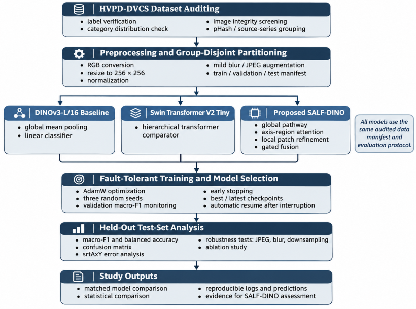
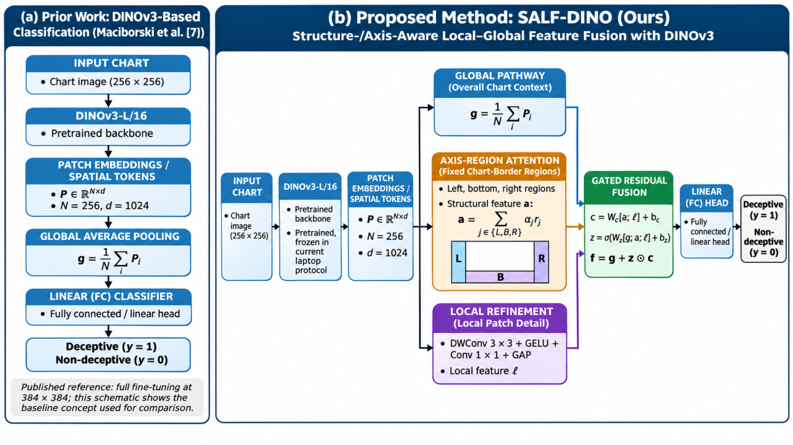
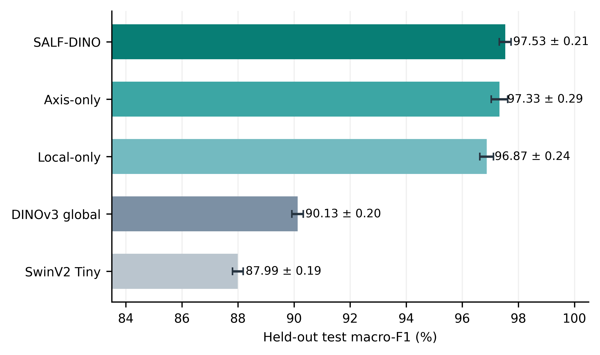
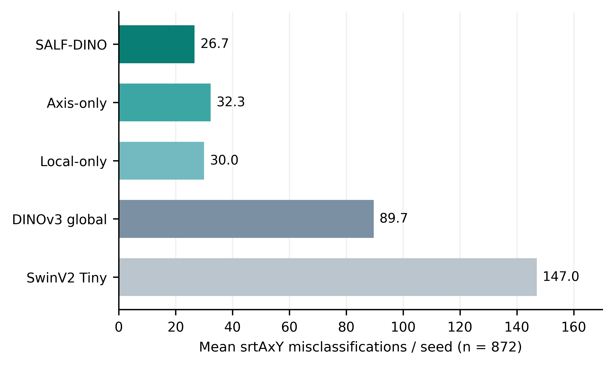
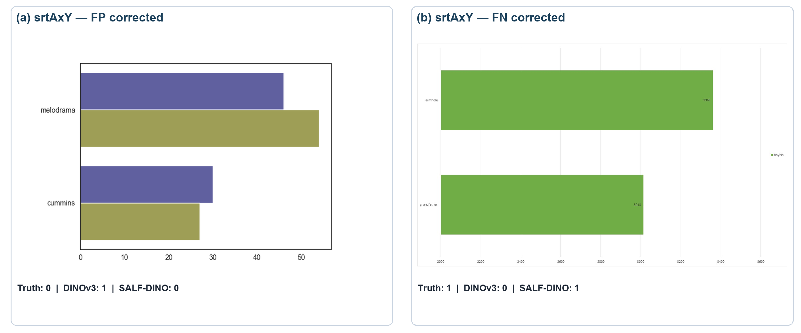
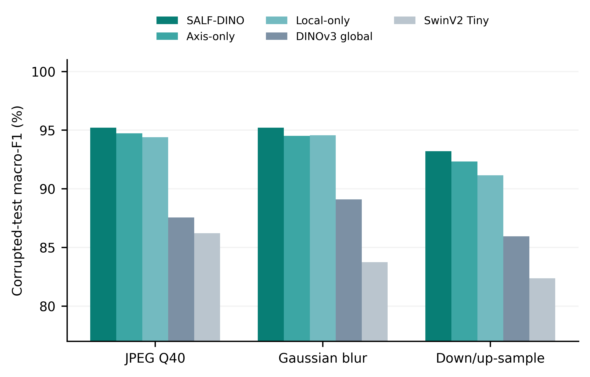

# Axis-Aware Local–Global Feature Fusion for Robust Deceptive Chart Detection

## Interim follow-up experiment evidence (26 November 2026)

**20 of 21 planned model-seed runs validated**: original 15/15, content-region control 3/3, additive residual control 2/3. The third additive residual seed (2025) is pending. The original 23 November release below is retained as a historical evidence snapshot. Follow-up experiments reuse the same held-out benchmark and were designed after inspecting the initial results; they are exploratory, not external validation.

| Control | Validated seeds | Test macro-F1 mean +/- sample SD | Trainable parameters |
|---|---|---:|---:|
| Content-ranked regional pooling | 42, 123, 2025 | 97.07 +/- 0.23% | 8,403,970 |
| Additive residual (no multiplicative gate) | 42, 123 only | 96.94 +/- 0.14% | 8,403,970 |

The content-region comparison favors SALF-DINO by +0.46 percentage points (95% paired group-bootstrap interval +0.14 to +0.81, as reported in the interim manuscript); the additive residual contrast is descriptive (+0.71 pp on two matched seeds), with final inference pending. See [follow-up evidence](results/followup_20261126/) and [per-seed metrics](results/followup_20261126/per_seed_metrics.csv). Updated manuscript figures and the final 21-run analysis are not yet part of the public release.

**Research repository for the IEEE Access manuscript**  
**Proposed method:** **SALF-DINO** (discussed inside the paper, not used as the paper-title prefix)  
**Evidence release:** 23 November 2026 · **15/15 validated experiments**

This repository accompanies the manuscript **“Axis-Aware Local–Global Feature Fusion for Robust Deceptive Chart Detection.”** It preserves the verified experimental evidence and presents the **same Tables I–VIII and Figures 1–5, S1–S2** as the manuscript, alongside code, evaluation outputs, the fixed dataset manifest, and audit records. **All figure images displayed below were extracted from the final Word manuscript**, not recreated for the README. See [paper figure provenance](docs/PAPER_FIGURE_SOURCE_MAP.json).

**Authors:** Yuhefizar; Juanda Hakim Lubis; Mazlina Abdul Majid; Agus Perdana Windarto; Ronal Watrianthos.

> **Scope.** This is a controlled, frozen-backbone study on a largely synthetic chart dataset. The results do **not** establish real-world generalization, the isolated causal benefit of gating, or superiority over a previously published *fully fine-tuned* DINOv3 model.

## Contents

1. [Research questions and main contributions](#research-questions-and-main-contributions)
2. [Table I — Related-work positioning](#table-i--related-work-positioning)
3. [Table II and Supplementary Figure S1 — Dataset](#table-ii--dataset-and-source-images)
4. [Figures 1–2 and Table III — Methods](#figures-12-and-table-iii--methods)
5. [Tables IV–VIII and Figures 3–5 — Results and Discussion](#tables-ivviii-and-figures-35--results-and-discussion)
6. [Supplementary Figure S2 — Actual corrected classifications](#supplementary-figure-s2--genuine-held-out-examples)
7. [Reproducibility, limitations, and citations](#reproducibility-and-research-boundaries)

## Experimental overview

| Audit dimension | Verified protocol |
|---|---|
| Dataset | HVPD-DVCS: **24,480** synthetic charts |
| Ground-truth class distribution | **12,050 deceptive; 12,430 non-deceptive** |
| Train / validation / held-out test | **19,544 / 2,465 / 2,471** |
| Held-out test class distribution | **1,214 deceptive; 1,257 non-deceptive** |
| Source groups in held-out test | **733** |
| Models | Frozen DINOv3 global average, SwinV2 Tiny, SALF-DINO, axis-only, local-only |
| Random seeds | **42, 123, 2025** |
| Completed runs | **5 configurations × 3 seeds = 15/15** |
| Input | **256 × 256 RGB** |
| Training | Frozen pretrained encoders, trainable classification/fusion heads, maximum 20 epochs |
| Selection | Best validation macro-F1; held-out test only for final evaluation |
| Split manifest SHA-256 | `c8fc29542853326611668612b0444b7c044853e9ca483c591fba65bbc86b4d7a` |

The group-disjoint split and near-duplicate audit reduce leakage risk. They do not prove that all latent relations among synthetically generated charts are eliminated. All reported results pertain to this fixed protocol.

## Research questions and main contributions

**Novelty positioning:** The proposed contribution is a *task-specific, annotation-free chart-border structural prior* integrated with global and local DINOv3 patch information—not the invention of attention, convolution, local–global fusion, or residual gating in isolation.

| Research Question (RQ) | Main Contribution (C) | Experimental evidence |
|---|---|---|
| **RQ1.** To what extent does axis-aware local–global fusion improve overall classification performance and reduce truncated-Y-axis detection errors compared with DINOv3 and SwinV2 baselines under a shared group-disjoint evaluation protocol? | **C1 — Axis-aware local–global feature fusion.** SALF-DINO combines fixed chart-border attention, local patch refinement, global DINOv3 context, and gated residual fusion; the key failure-mode finding is fewer false positives on legitimate axis layouts. | **Table IV; Table VI; Figures 3–4; Figure S2** |
| **RQ2.** What are the individual contributions of axis-aware attention and local patch refinement, and how statistically reliable are their incremental improvements across three random seeds? | **C2 — Component-level validation and uncertainty analysis.** Three-seed axis-only and local-only comparisons with paired held-out-group bootstrap distinguish the supported structural contribution from uncertain additional gains. | **Table V** |
| **RQ3.** How robust is SALF-DINO to image-quality degradation, and what computational trade-offs arise in terms of trainable parameters and inference throughput? | **C3 — Robustness and computational trade-off evaluation.** Controlled image corruptions and measured model capacity/throughput establish absolute performance and its limitations. | **Table VII; Table VIII; Figure 5** |

The complete model's advantage over **axis-only** is small and its bootstrap interval includes zero; a **gate-disabled** experiment was not run. These limits are part of the evidence, not findings to suppress.

## Table I — Related-work positioning

**Table I. Comparison of representative methods for deceptive chart detection.** The citation numbering follows the manuscript reference list.

| Study | Primary objective | Technical approach | Direct relevance and distinction |
|---|---|---|---|
| Lo and Qu [3] | Detect misleading charts | Prompt-based multimodal LLM analysis | Reasoning-focused detection; different evaluation protocol |
| Das and Mueller [4] | Detect, explain, and repair charts | Interactive multimodal LLM dashboard | Interpretability and remediation |
| Song et al. [10] | Detect edited chart images | Watermarking and intent inference | Image tampering differs from deceptive original chart encoding |
| Chen et al. [6] | Deconstruct chart layouts | SVG semantic and spatial extraction | Shows the value of axes and layout representation |
| Zhou et al. [5] | Recover chart knowledge | Object detection, OCR, knowledge graphs | Structural inspiration rather than a binary HVPD classifier |
| Liu et al. [8] | General visual representation | Swin Transformer V2 | Independent architectural comparator |
| Xu et al. [11]; Shi et al. [12] | Fine-grained visual classification | Multi-granularity selection and local refinement | Establish prior art for local–global feature modeling |
| Maciborski et al. [7] | Deceptive chart classification | DINOv3-L/16 using HVPD | Primary predecessor; documented axis-category and robustness weaknesses |
| **This study (SALF-DINO)** | Deceptive chart classification | DINOv3, axis-region attention, local refinement, gated fusion | Tests task-specific structural fusion on matched HVPD data |

**Important comparison boundary:** Maciborski et al. [7] reported **98.09% macro-F1** under a **fully fine-tuned** DINOv3 setup. Our **90.13%** frozen DINOv3 global-average baseline is separately trained on our audited split. These numbers cannot be treated as results of a like-for-like cross-paper comparison.

## Table II — Dataset and source images

The **Harmful Visual Plots Dataset (HVPD)** includes the Deceptive Visualization Classification Subset (DVCS), used for the paper's binary deceptive-chart task. The published DVCS class/category breakdown is:

**Table II. Published composition of HVPD-DVCS.**

| Category | Deceptive | Non-deceptive | Total |
|---|---:|---:|---:|
| Truncated Y axis (`srtAxY`) | 4,200 | 4,200 | 8,400 |
| Two Y axes (`twoYaxes`) | 2,046 | 512 | 2,558 |
| 3D pie charts (`3dpie`) | 1,016 | 3,072 | 4,088 |
| Colors and missing scales (`colNoScl`) | 2,560 | 0 | 2,560 |
| Trend hiding through stacking (`trdStck`) | 2,228 | 4,646 | 6,874 |
| **Total** | **12,050** | **12,430** | **24,480** |

The audit used 24,480 valid synthetic DVCS charts and excluded 187 auxiliary web examples. Published category totals and the exact experimental split serve different purposes; the latter is documented in [`data/split_manifest.csv`](data/split_manifest.csv). Because `colNoScl` contains only deceptive ground truth, per-category evaluation reports deception recall/error counts rather than binary-class macro-F1.

**Supplementary Figure S1. Genuine HVPD-DVCS training examples:** (a) non-deceptive and (b) deceptive truncated-Y-axis charts. Both source-image labels and SHA-256 hashes were checked against the audited manifest; **neither is a model prediction**.

Source provenance: [`data/representative_samples_manifest.csv`](data/representative_samples_manifest.csv). A wider nine-panel category overview is available separately at [`figures/Fig_HVPD_DVCS_Representative_Train_Samples.png`](figures/Fig_HVPD_DVCS_Representative_Train_Samples.png), without substituting it for the paper's Figure S1.

## Figures 1–2 and Table III — Methods

### Figure 1 — Research framework

The paper's research workflow links dataset auditing, fixed group-disjoint train/validation/test allocation, shared preprocessing, controlled backbone/head comparisons, checkpointed training, and held-out assessment.

*Figure 1. Research framework of the proposed study, showing HVPD-DVCS auditing, matched model comparisons, fault-tolerant training, and test-set analysis.*

### Figure 2 — Proposed SALF-DINO architecture

The proposed classifier has three complementary information pathways: **(i)** spatial-token global pooling from a frozen DINOv3-L/16 encoder; **(ii)** learned attention over **fixed left, lower, and right chart-border strips**; and **(iii)** depthwise **3 × 3** local patch refinement followed by pointwise projection. Gated residual adaptation combines their descriptors before binary classification.

The strips are an **annotation-free axis-layout prior**, *not* predicted axis coordinates, OCR recognition, or an axis-segmentation output.

*Figure 2. Proposed SALF-DINO architecture showing the global DINOv3 pathway, fixed chart-border region attention, local depthwise-convolutional refinement, and gated residual fusion before binary classification.*

### Table III — Matched experimental protocol

**Table III. Configured five-configuration experimental protocol.** Each model uses the identical audited sample identities and validation selection criterion. SwinV2 Tiny is an independent **non-parameter-matched** comparator.

| Component | Configuration |
|---|---|
| Dataset and partitioning | Audited HVPD-DVCS; shared group-disjoint split |
| DINOv3 baseline | Frozen ViT-L/16 spatial-token average pooling + linear head |
| Additional comparator | Frozen Swin Transformer V2 Tiny + linear head |
| Proposed model | SALF-DINO with global, axis-region, local, and gated residual fusion components |
| Input/backbone | 256 × 256 RGB; frozen pretrained encoders |
| Random seeds | 42, 123, 2025 |
| Optimizer/scheduler | AdamW; head learning rate 5 × 10⁻⁴; weight decay 0.05; two warm-up epochs; cosine decay |
| Loss/precision | Label-smoothed cross-entropy (ε = 0.2); CUDA mixed precision |
| Training budget | Up to 20 epochs; batch size 2; gradient accumulation 8 (nominal effective batch 16) |
| Model selection | Validation macro-F1; early-stopping patience 5; minimum delta 0.0005; minimum 5 epochs |
| Recovery | Best/latest checkpoints with optimizer/scheduler/scaler/RNG state |
| Evaluation | Macro-F1, balanced accuracy, per-category errors, held-out corruption tests, ablations, bootstrap |

The model–seed runs were trained on Kaggle NVIDIA Tesla T4 GPU sessions and audited after syncing the outputs. The held-out test set was not used for early stopping.

## Tables IV–VIII and Figures 3–5 — Results and Discussion

### Table IV and Figure 3 — Three-seed overall performance (RQ1 / C1)

**Table IV. Held-out test performance across three seeds.** Macro-F1 is **mean ± sample standard deviation** across three independently seeded runs, not an interval for dataset generalization. Deceptive recall refers to the positive class.

| Architecture | Macro-F1 (%) | Deceptive recall (%) |
|---|---:|---:|
| **SALF-DINO** | **97.53 ± 0.21** | **97.78** |
| Axis-only | 97.33 ± 0.29 | 96.98 |
| Local-only | 96.87 ± 0.24 | 97.50 |
| DINOv3 global | 90.13 ± 0.20 | 95.25 |
| SwinV2 Tiny | 87.99 ± 0.19 | 90.50 |

*Figure 3. Test macro-F1 (mean ± sample standard deviation across three independent seeds) for the five completed experimental configurations.*

Under this **frozen-backbone** protocol, SALF-DINO exceeds retrained frozen DINOv3 global average by **7.41 percentage points** and the independent SwinV2 Tiny comparator by **9.54 points**. This supports a task-specific representational advantage, not a claim of superiority over the published fully fine-tuned DINOv3 configuration.

### Table V — Bootstrap uncertainty and branch ablations (RQ2 / C2)

We use **2,000 paired bootstrap replications** over the same **733 held-out test groups**, averaging differences across matched training seeds.

**Table V. Paired held-out group bootstrap comparisons.**

| Comparator with SALF-DINO | Mean Δ macro-F1 (pp) | 95% group-bootstrap interval (pp) |
|---|---:|---:|
| DINOv3 global | +7.41 | +6.38 to +8.45 |
| SwinV2 Tiny | +9.54 | +8.42 to +10.71 |
| Axis-only | +0.20 | −0.15 to +0.54 |
| Local-only | +0.66 | +0.32 to +1.02 |

**Interpretation:** The +0.66 pp advantage over **local-only** is more clearly supported than the +0.20 pp advantage over **axis-only**, whose interval **includes zero**. The evidence therefore favors the added **chart-border structural pathway** more strongly than an unconditional local–global synergy claim. No gate-disabled experiment was run. Axis-only and local-only retain the same implemented trainable-head parameter count as full SALF-DINO, so these are **pathway** ablations rather than compressed architectures.

The bootstrap estimates are **conditional on the trained networks and held-out groups**; they are not cross-dataset confidence intervals or independent analyses of all possible training seeds.

### Table VI and Figure 4 — Truncated-Y-axis errors (RQ1 / C1)

The held-out `srtAxY` subset contains **872 charts**, including **436 deceptive** and **436 non-deceptive** images. Values below are mean errors per seed.

**Table VI. srtAxY errors on 872 test charts (seed means).**

| Model | All errors | False negatives | False positives |
|---|---:|---:|---:|
| SALF-DINO | 26.7 | 12.7 | 14.0 |
| Axis-only | 32.3 | 18.7 | 13.7 |
| Local-only | 30.0 | 13.3 | 16.7 |
| DINOv3 global | 89.7 | 16.0 | 73.7 |
| SwinV2 Tiny | 147.0 | 60.7 | 86.3 |

*Figure 4. Mean number of srtAxY misclassifications per seed on the identical 872-chart test subset (lower is better).*

Relative to DINOv3 global pooling, SALF-DINO reduces mean `srtAxY` errors from **89.7 to 26.7 (~70.3%)**, driven primarily by a drop in **false alarms on non-deceptive charts** from **73.7 to 14.0 (~81.0%)**. Deceptive false negatives decrease more modestly (16.0 to 12.7). This supports the chart-border hypothesis but does **not** prove that learned attention precisely localizes actual axis lines.

Other held-out category supports are `trdStck` (696), `colNoScl` (253, deceptive-only), `twoYaxes` (255), and `3dpie` (395). Mean SALF-DINO errors remain concentrated on `trdStck` (**32.7**), indicating that chart-border features do not resolve all stacking/legend semantics.

### Supplementary Figure S2 — Genuine held-out examples

Two **actual held-out `srtAxY` images** from **seed 42** illustrate a DINOv3 false positive and a false negative, both correctly classified by SALF-DINO. They are **illustrative**; aggregate results are given in Table VI.

*Supplementary Figure S2. Two genuine held-out srtAxY chart images (seed 42): (a) a false positive and (b) a false negative of DINOv3 global pooling, both correctly classified by SALF-DINO.*

The exact image identities, source hashes, truth labels, predictions, probability scores, and deterministic selection are preserved in [`data/srtaxy_qualitative_cases_manifest.csv`](data/srtaxy_qualitative_cases_manifest.csv).

### Table VII and Figure 5 — Image degradation (RQ3 / C3)

**Table VII. Test macro-F1 under controlled corruptions (%).** The same test images were evaluated under **JPEG Q40**, **5 × 5 Gaussian blur (σ = 1.2)**, and **downsampling followed by upsampling**.

| Architecture | JPEG Q40 | Blur | Downsample |
|---|---:|---:|---:|
| **SALF-DINO** | **95.21** | **95.21** | **93.21** |
| Axis-only | 94.73 | 94.51 | 92.33 |
| Local-only | 94.39 | 94.56 | 91.14 |
| DINOv3 global | 87.56 | 89.09 | 85.94 |
| SwinV2 Tiny | 86.21 | 83.74 | 82.37 |

*Figure 5. Mean held-out macro-F1 under JPEG compression, Gaussian blur, and downsampling/upsampling, averaged over three seeds.*

SALF-DINO retains the **highest absolute** macro-F1 in all three tests. Its drops from clean performance are **2.32**, **2.32**, and **4.32 percentage points**, respectively. However, the frozen DINOv3 global model has smaller relative losses under blur (**1.03 pp**) and downsampling (**4.19 pp**) despite lower absolute corrupted-test scores. Thus, **robustness is conditional on these measured perturbations**; neither perturbation invariance nor adversarially certified robustness is established.

### Table VIII — Parameter cost and evaluation throughput (RQ3 / C3)

**Table VIII. Parameter count and measured evaluation throughput.**

| Architecture | Total parameters (M) / trainable (M) | Images/s* |
|---|---:|---:|
| SALF-DINO | 311.48 / 8.4040 | 13.3 |
| Axis-only | 311.48 / 8.4040 | 13.0 |
| Local-only | 311.48 / 8.4040 | 12.4 |
| DINOv3 global | 303.08 / 0.0021 | 11.3 |
| SwinV2 Tiny | 27.58 / 0.0015 | 30.7 |

*Images/s is an observed mean across three evaluations, **not** a synchronized single-device speed benchmark.* The SALF-DINO head has approximately **8.404 M trainable parameters**, whereas the frozen DINOv3 global linear head has approximately **0.00205 M**. The gain in detection performance therefore incurs a substantial head-capacity cost, and recorded throughput cannot support a claim of statistically proven efficiency superiority.

## Reproducibility and research boundaries

### Experiment outputs and source files

| File/folder | Research purpose |
|---|---|
| [`data/split_manifest.csv`](data/split_manifest.csv) | Immutable group-disjoint split, labels, image identities and hashes |
| [`data/representative_samples_manifest.csv`](data/representative_samples_manifest.csv) | Original training-image provenance for Figure S1 and nine-panel sample montage |
| [`data/srtaxy_qualitative_cases_manifest.csv`](data/srtaxy_qualitative_cases_manifest.csv) | Held-out images, labels, seed-42 predictions, and hashes for Figure S2 |
| [`results/per_seed_metrics.csv`](results/per_seed_metrics.csv) | Metrics, parameter counts, timing, epochs for all 15 model–seed runs |
| [`results/model_summary.csv`](results/model_summary.csv) | Three-seed model means, sample SD and deceptive recall |
| [`results/paired_group_bootstrap.csv`](results/paired_group_bootstrap.csv) | Paired effect sizes and confidence bounds |
| [`results/category_error_summary.csv`](results/category_error_summary.csv) | Category-specific error aggregates and positive recall |
| [`results/confusion_matrices.csv`](results/confusion_matrices.csv) | Held-out confusion matrices for every seed |
| [`results/corruption_summary.csv`](results/corruption_summary.csv) | Performance under matched corruption conditions |
| [`results/throughput.csv`](results/throughput.csv) | Recorded evaluation throughput and parameter counts |
| [`results/raw/`](results/raw/) | **90 original per-run evaluation files** from 15 validated runs; not model weights |
| [`results/evidence_full.json`](results/evidence_full.json) | Consolidated experiment and evidence metadata |
| [`figures/paper/`](figures/paper/) | **Exact Figure 1–5, Figure S1–S2 images extracted from the final Word manuscript** |
| [`docs/PAPER_FIGURE_SOURCE_MAP.json`](docs/PAPER_FIGURE_SOURCE_MAP.json) | Paper-to-file mapping with source manuscript hash, captions, pixel dimensions and image SHA-256 |
| [`docs/RESULTS_AND_DISCUSSION.md`](docs/RESULTS_AND_DISCUSSION.md) | Extended interpretation of matched experimental evidence |
| [`docs/RQ_CONTRIBUTIONS.md`](docs/RQ_CONTRIBUTIONS.md) | Paper-aligned three Research Questions / three Main Contributions |
| [`docs/RELEASE_SHA256.json`](docs/RELEASE_SHA256.json) | Evidence-release integrity hashes |
| [`scripts/`](scripts/), [`notebooks/`](notebooks/) | Code, checks, experiment orchestration, and study notebooks |

### Data availability

The source chart images are obtained from [HVPD — Harmful Visual Plots Dataset](https://huggingface.co/datasets/WieszczUrsynowa/HVPD-HarmfulVisualPlotsDataset), subject to the source terms. This study uses the **Deceptive Visualization Classification Subset**, not the separate chart-identification subset. Raw image archives, large checkpoint weights, author manuscripts, and private API credentials are **not redistributed** in this public repository. Completed checkpoint metadata and original evaluation files were audited in the research workspace.

### Scientific limitations

1. The evidence is confined to **synthetic HVPD-DVCS** under the fixed source-group-disjoint test split. External real-world generalization was not established.
2. The chart-border attention samples **fixed spatial strips**, not annotated or detected true axis coordinates; unusual layouts may violate this prior.
3. There is **no gate-disabled** or equal-capacity generic fusion-head control; the isolated gate benefit and separation from capacity effects are unproven.
4. The extra **+0.20 pp** over axis-only is **not decisively separated from zero** by the reported bootstrap CI.
5. The robustness experiments are limited to JPEG, Gaussian blur and downsampling; timing is descriptive, not a controlled hardware benchmark.
6. The original fully fine-tuned Maciborski et al. results are **not protocol-matched** to the frozen-backbone results here.

### Source attribution

**Primary predecessor:** Maciborski, K. J., Struniawski, K., and Wierzbicki, A. (2026). *Combating Visual Misinformation: Automated Detection of Deceptive Chart Design Using Vision Transformers*. **IEEE Access**. [doi:10.1109/ACCESS.2026.3697128](https://doi.org/10.1109/ACCESS.2026.3697128).

**Data:** [WieszczUrsynowa/HVPD-HarmfulVisualPlotsDataset](https://huggingface.co/datasets/WieszczUrsynowa/HVPD-HarmfulVisualPlotsDataset).

Citation numbers **[1]–[12]** in Table I refer to the manuscript's reference list. The companion manuscript has **not** been assigned its own published DOI.
