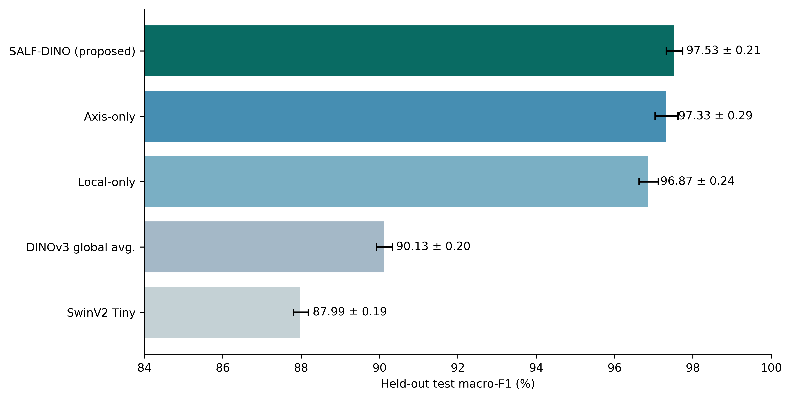
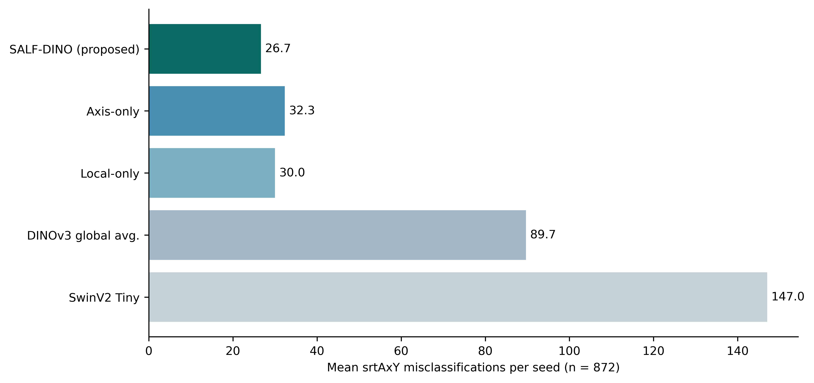
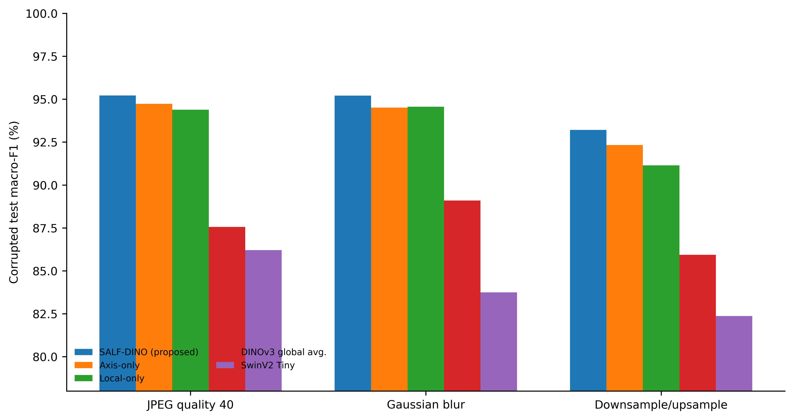

# Results and Discussion — SALF-DINO (15/15 validated)

**Manuscript title:** *Axis-Aware Local–Global Feature Fusion for Robust Deceptive Chart Detection*

**Proposed architecture:** SALF-DINO (inside the manuscript, not in the paper title).

**Release audit:** 23 November 2026. All five model families × three training seeds were validated against checkpoint metadata, original prediction CSVs, and test result files on the same manifest digest.

## Experimental basis

The Harmful Visual Plots Dataset, Deceptive Visualization Classification Subset (HVPD-DVCS), supplied **24,480** synthetic charts: **19,544 training**, **2,465 validation**, and **2,471 held-out test** images. The test partition comprises 1,257 non-deceptive and 1,214 deceptive charts, grouped into 733 disjoint source-series/near-duplicate groups. All 15 runs use the exact split manifest, with SHA-256 `c8fc29542853326611668612b0444b7c044853e9ca483c591fba65bbc86b4d7a`.

The five conditions are: frozen DINOv3-L/16 with global pooling and linear prediction, frozen Swin Transformer V2 Tiny with a linear classifier, SALF-DINO's axis-aware local–global fusion head, and axis-only and local-only branch ablations. All are evaluated at 256×256 input resolution, seeds 42/123/2025, identical test identities, AdamW head optimization, up to 20 epochs, and validation-macro-F1 checkpoint selection. SwinV2 is an **independent non-parameter-matched** comparator. Unlike the fully fine-tuned prior work by Maciborski et al. (DOI: 10.1109/ACCESS.2026.3697128), our DINOv3 encoder stays frozen. Cross-study scores cannot be read as a like-for-like ranking.

## A. Overall classification performance (RQ1)

| Model | Mean test macro-F1 ± sample SD | Mean deceptive recall | n |
|---|---:|---:|---:|
| **SALF-DINO** | **97.53 ± 0.21%** | **97.78%** | 3 |
| Axis-only | 97.33 ± 0.29% | 96.98% | 3 |
| Local-only | 96.87 ± 0.24% | 97.50% | 3 |
| Frozen DINOv3 global average | 90.13 ± 0.20% | 95.25% | 3 |
| SwinV2 Tiny | 87.99 ± 0.19% | 90.50% | 3 |

Within this controlled frozen-backbone setup, the full model exceeds its matched DINOv3 representation-only baseline by **7.41 percentage points** and the independent SwinV2 comparator by **9.54 points**. The result demonstrates that the task-specific representation head can exploit discriminative features not captured by the global pooled descriptor alone. It does **not** demonstrate superiority over fully fine-tuned DINOv3 or independent real-world data.

## B. Branch contribution and paired group bootstrap (RQ2)

Uncertainty is estimated from **2,000 paired test-group bootstrap replicates**. The same sampled groups are used for both models, with the resulting difference averaged over corresponding seeds. This is uncertainty *conditional on the three trained model pairs*, not across independent benchmark datasets or an independent estimate of all possible training seeds.

| Compared with SALF-DINO | Δ macro-F1, percentage points | 95% bootstrap interval |
|---|---:|---:|
| Frozen DINOv3 global average | +7.41 | [+6.38, +8.45] |
| SwinV2 Tiny | +9.54 | [+8.42, +10.71] |
| Axis-only | +0.20 | [−0.15, +0.54] |
| Local-only | +0.66 | [+0.32, +1.02] |

The near-zero comparison with **axis-only** is a central negative/qualified finding: its interval crosses zero. Thus, the incremental benefit of the extra local refinement beyond an already strong axis-aware branch is not resolved in this split. The +0.66-point result versus local-only indicates a stronger gain when introducing axis-aware context on top of local features. No gate-disabled control was executed; an isolated effect of gating is not claimed. Ablations retain the same implemented parameter count, so they do not constitute an efficiency ablation.

## C. Axis-related mistakes and category diagnostics (RQ1)

For the **srtAxY** subset, the held-out sample count is 872 (436 deceptive). The mean per-seed errors are:

| Model | Errors | False negatives | False positives |
|---|---:|---:|---:|
| SALF-DINO | 26.7 | 12.7 | 14.0 |
| Axis-only | 32.3 | 18.7 | 13.7 |
| Local-only | 30.0 | 13.3 | 16.7 |
| Frozen DINOv3 global average | 89.7 | 16.0 | 73.7 |
| SwinV2 Tiny | 147.0 | 60.7 | 86.3 |

SALF-DINO reduces average srtAxY errors by about **70%** relative to frozen DINOv3. The dominant contributor is not the modest difference in deceptive recall (97.09% vs 96.33%), but the sharply reduced **false-positive count** on *non-deceptive* charts (73.7 down to 14.0). This helps identify the precise chart-design failure mechanism: a global descriptor appears prone to treating nonstandard but legitimate Y-axis design as deceptive in this audited split.

Among the other categories, SALF-DINO averages 32.7 errors on `trdStck` (n=696), 1.0 on `colNoScl` (n=253), 0.3 on `twoYaxes` (n=255), and 0.3 on `3dpie` (n=395). Its weakest remaining category is stacked-trend concealment. The `colNoScl` class has only deceptive ground truth and must be evaluated using deceptive recall/errors rather than within-category binary macro-F1.

## D. Perturbation robustness (RQ3)

Mean held-out test macro-F1 on the identical source images after the three image-quality transformations:

| Model | JPEG Q40 | Gaussian blur | Downsample/upsample |
|---|---:|---:|---:|
| SALF-DINO | **95.21%** | **95.21%** | **93.21%** |
| Axis-only | 94.73% | 94.51% | 92.33% |
| Local-only | 94.39% | 94.56% | 91.14% |
| Frozen DINOv3 global average | 87.56% | 89.09% | 85.94% |
| SwinV2 Tiny | 86.21% | 83.74% | 82.37% |

SALF-DINO retains the highest **absolute** corrupted-test macro-F1 for each condition. Nevertheless, the absolute *drop* from its own clean value is 2.32, 2.32, and 4.32 points, respectively. Frozen DINOv3 loses fewer points under blur (1.03) and downsampling (4.19), despite having lower absolute scores. Therefore, “robust” in this paper refers to observed corrupted-test classification performance under the chosen perturbations, **not** uniformly best relative invariance or adversarially certified robustness.

## E. Capacity, feasibility, and validity boundary

The proposed model contains approximately **311.48 M** total parameters, **8.404 M** of them trainable. The DINOv3 global-average baseline contains **303.08 M** total and **0.00205 M** trainable parameters; SwinV2 Tiny contains **27.58 M** total and **0.00154 M** trainable parameters. This means the gain in predictive performance does not come without increased head complexity. The measured image throughput is recorded per seed in `results/throughput.csv`; without synchronized dedicated hardware profiling, those values are descriptive only.

Training was performed on remote Kaggle NVIDIA Tesla T4 GPUs; run integrity was verified after syncing to the research laptop. The source is predominantly synthetic. Chart-border strips provide only an axis-layout prior, **not** precise ground-truth axis detection; generalization to unconventional plot margins, arbitrary rotations, OCR-dependent deception and natural websites remains untested. No external dataset or gate-disabled ablation is reported.

## RQ conclusions

**RQ1:** Stronger overall macro-F1 and lower srtAxY error counts than retrained baselines within this split, especially reduced false positives. **RQ2:** Positive contrast versus local-only, but the small axis-only increment remains uncertain. **RQ3:** Higher absolute corrupted-test performance at the cost of more trainable parameters, with no universal reduction in clean-to-corrupted loss.

## Provenance and audit files

Exact source evidence is in `results/raw/` (15 configurations × six original evaluation files), `results/evidence_full.json` (protocol, bootstrap, per-category and corruption aggregates), `results/per_seed_metrics.csv`, and `data/split_manifest.csv`. No train/validation/test resplitting was done during analysis. Checkpoints are preserved on the research machine, not redistributed in this public repository.

Maciborski, K. J., Struniawski, K., & Wierzbicki, A. (2026). *Combating Visual Misinformation: Automated Detection of Deceptive Chart Design Using Vision Transformers*. IEEE Access. https://doi.org/10.1109/ACCESS.2026.3697128
